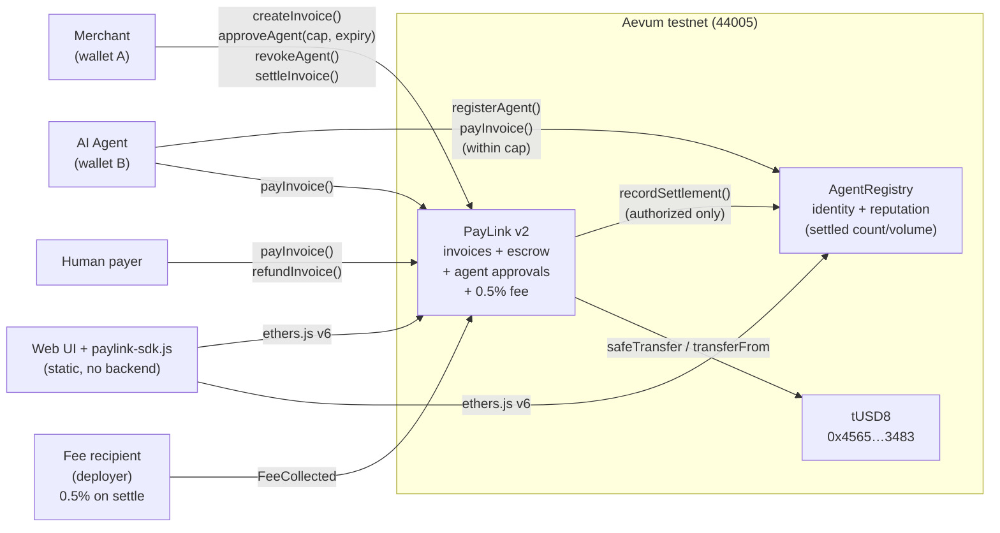

# Aevum Builder Challenge #1 — Aevum PayLink

> **STATUS: v2 DEPLOYED + E2E LIVE 16 Nov 2026 ~15:00 WIB — TARGET JUARA 1 ($800).**
> PayLink v2 `0x49841BDaA70a41D6a49dE1e87a6EF61215719167` + AgentRegistry
> `0x432de42876b6e4416979924FEC83D8B678f50fb3` on Aevum testnet (44005).
> 66/66 Foundry tests pass (38 v1 + 28 v2). Live E2E v2 PASSED on-chain
> (register → approve → pay ×2 to cap → cap-exceeded revert → revoke →
> revoked revert → settle ×2 with 0.5% fee + reputation 2 / 2.0 tUSD8).
> Repo: github.com/Strescco/paylink. Submit target 9 Des 2026 (tutup 11 Des 15:00 WIB).

## Proyek: Aevum PayLink

**Satu kalimat:** Invoice pembayaran stablecoin end-to-end di Aevum testnet — merchant membuat invoice dalam tUSD8, payer membayar, dana cair ke merchant, dengan expiry dan refund bila kedaluwarsa — **plus pembayaran agent-native**: merchant menyetujui agen AI dengan batas belanja (spending cap) + masa berlaku, agen membayar dalam batas itu, merchant bisa mencabut kapan saja, dan reputasi agen tercatat on-chain.

**Masalah yang diselesaikan:** penjual/freelancer/agen AI butuh cara menagih dalam stablecoin tanpa membangun backend pembayaran sendiri — cukup buat invoice on-chain, kirim link, terima tUSD8, semua tercatat dan bisa diverifikasi di explorer. Agen AI butuh cara membayar **dengan batas** — merchant tidak mau memberi agen akses tanpa batas ke dananya; PayLink v2 memberi agen izin berbatas (cap + expiry + revoke) yang ditegakkan kontrak, bukan janji off-chain.

## Arsitektur v2

Alur inti (ringkas):

1. Merchant membuat invoice: jumlah tUSD8, payer (opsional: siapa saja / alamat tertentu), memo, masa berlaku.
2. Payer menyetujui (approve) tUSD8 lalu membayar invoice — dana masuk escrow kontrak.
3. Merchant menarik dana (settle) ke wallet-nya — dikurangi fee protokol 0,5% yang masuk ke fee recipient; refund selalu bebas fee dan mengembalikan jumlah penuh.
4. Jika invoice kedaluwarsa sebelum dibayar → tidak bisa dibayar lagi, dana tidak pernah bergerak.
5. Jika sudah dibayar tapi merchant tidak kunjung menarik dalam jendela klaim → payer bisa refund.
6. **Agen (v2):** agen mendaftarkan dirinya di AgentRegistry → merchant menyetujui agen dengan cap belanja + masa berlaku → agen membayar invoice dalam batas cap → merchant bisa revoke kapan saja → invoice yang dibayar agen dan berhasil settle menambah reputasi agen (jumlah + volume) di registry.

## Model bisnis + roadmap mainnet

**Pendapatan:** fee protokol **0,5% (50 bps)** dari setiap settle — dibayar dari jumlah invoice, terlihat oleh merchant di UI (jumlah bersih ditampilkan sebelum settle) dan di event `FeeCollected`. Refund selalu gratis. Pada volume $10.000/bulan, fee = $50/bulan; pada $100.000/bulan, fee = $500/bulan. Fee saat ini masuk ke deployer (wallet testnet); di mainnet fee masuk ke treasury multisig yang dipublikasikan.

**Siapa yang membayar:** merchant tidak membayar di muka — fee hanya terjadi saat uang benar-benar cair (settle). Tidak ada biaya langganan, tidak ada biaya per invoice yang dibuat.

**Roadmap mainnet (QDay mainnet direncanakan Feb 2027):**
1. Migrasi registry ke registry resmi QDay (ERC-8004) begitu alamatnya dipublikasikan — AgentRegistry kami mengikuti bentuk ERC-8004 (identitas + reputasi on-chain) agar migrasi hanya mengganti alamat registry.
2. Integrasi paymaster resmi QDay (gas dalam USD8) begitu alamat paymaster dipublikasikan — saat ini EOA masih butuh tQDAY untuk gas.
3. Integrasi facilitator x402 resmi begitu endpoint-nya dipublikasikan — saat ini pola x402 (HTTP 402 + link invoice PayLink) sudah bisa dipakai lewat `paylink-sdk.js` (`PayLinkSDK.invoicePayUrl`).
4. Fee dialihkan ke treasury + DAO-lite: merchant besar bisa mengajukan penyesuaian fee lewat voting sederhana (di luar scope hackathon).
5. Reputasi agen dipakai untuk penawaran: merchant bisa menetapkan cap lebih besar otomatis untuk agen bereputasi tinggi (di luar scope hackathon — saat ini cap selalu manual).

## Catatan jujur (yang TIDAK kami klaim)

- **Fitur agen di PayLink v2 dibangun sendiri, on-chain, oleh kami** — bukan integrasi dengan infrastruktur QDay. QDay mengklaim smart account / session key / paymaster / facilitator x402 / ERC-8004 "live on testnet", tapi **tidak mempublikasikan satu pun alamat kontrak, endpoint, atau SDK** untuk Aevum testnet (wiki.qday.info FAQ §5.1–5.4: "will be published in the docs"). Karena itu kami tidak bisa — dan tidak — mengklaim memakai infra tersebut. Yang kami bangun adalah padanannya yang ditegakkan kontrak: approval agen (cap + expiry + revoke), registry identitas + reputasi, dan pola x402 berbasis invoice.
- **Belum ada merchant sungguhan / traction.** Semua invoice di testnet adalah demo (merchant + agen adalah wallet testnet kami). Reputasi agen di registry bisa diverifikasi di testnet, tapi belum ada pengguna nyata sebelum 9 Des.
- **Fee recipient saat ini adalah deployer** (wallet testnet), bukan treasury multisig — itu pekerjaan mainnet.
- **Source contract belum terverifikasi di explorer** (verifikasi Blockscout gagal 2× di v1; akan dicoba lagi untuk v2). Source lengkap bisa dibaca di repo ini.

Detail lengkap alur, kontrak, fungsi, event, dan kasus uji ada di `ARCHITECTURE.md`.

## Link resmi

| Keperluan | Link |
|---|---|
| Halaman hackathon (MoonHub) | https://moonhub.tools/hackathons/aevum-builder-challenge-1-aabed41f03e2 |
| Pendaftaran / submit | via DoraHacks (tautan "View Details" di halaman MoonHub di atas) |
| Situs QDay | https://qday.io/ |
| Dokumen resmi QDay (Wiki) | https://wiki.qday.info/ |
| Panduan mulai Aevum Testnet (PQA Labs, 16 Okt 2026) | https://pqalabs.medium.com/aevum-testnet-how-do-i-get-started-qday-4dd0a6d64a34 |
| Starter kit resmi (Google Drive, dicek saat window dibuka) | https://drive.google.com/file/d/1YL574BFJTnZ9Z-WzkZMyuQnWNUOgUJ6l/view?usp=sharing |
| Explorer Aevum testnet | https://explorer-test.qday.info |
| Faucet gas testnet | https://faucet.qday.info |

## Timeline resmi (terverifikasi dari halaman MoonHub, dicek 15 Nov 2026)

| Tahap | HKT | WIB (UTC+7) | UTC |
|---|---|---|---|
| Registrasi dibuka + starter kit dirilis | 16 Nov 2026, 14:00 | **16 Nov 2026, 13:00** | 16 Nov, 06:00 |
| Build window | 16 Nov – 11 Des 2026 | 16 Nov 13:00 WIB – 11 Des 15:00 WIB | — |
| **Submit ditutup** | **11 Des 2026, 16:00** | **11 Des 2026, 15:00** | 11 Des, 08:00 |
| Judging | 12–14 Des 2026 | 12–14 Des 2026 | — |
| Demo Day (Top 5, presentasi 3–5 menit via video call) | 15 Des 2026, 14:00 | 15 Des 2026, 13:00 | 15 Des, 06:00 |

**Target internal kami: submit 9 Des 2026** — dua hari sebelum deadline, sebagai buffer bila ada masalah verifikasi/deploy.

## Hadiah

Total **$1.500 USDT**: 1st **$800** / 2nd **$500** / 3rd **$200**.

**Bonus non-uang:** pemenang mendapat fast track ke program builder mainnet QDay (mainnet direncanakan Februari 2027).

## Syarat entry (ringkas, dari halaman resmi)

- Solo boleh, atau tim 2–4 orang (dibentuk sebelum event).
- **Satu alur pembayaran stablecoin end-to-end di Aevum testnet (tUSD8):** smart contract + interface/script + source terverifikasi + demo singkat.
- Semua smart contract berjalan di Aevum testnet, memakai test token saja.
- Submit: repo GitHub publik + bukti integrasi Aevum + live deployment / Docker image + dokumentasi.
- Top 5: presentasi video call 3–5 menit.
- Dilarang: malicious code, menyerang platform/peserta lain.

## Testnet Aevum (terverifikasi 15 Nov 2026 — lihat `RESEARCH.md`)

| Parameter | Nilai |
|---|---|
| Chain ID | **44005** |
| RPC | **https://rpc-test.qday.info** |
| Gas token | test-$QDAY (tQDAY, tanpa nilai uang) |
| Faucet gas | **https://faucet.qday.info** (klaim pertama; setelah itu widget faucet di Wiki) |
| Explorer | https://explorer-test.qday.info |
| Token pembayaran | **tUSD8** (test stablecoin USD8) |
| Alamat kontrak tUSD8 | **DITEMUKAN 16 Nov 2026** — `0x456569838f1d43009A91ebA4263147Afd7233483` (6 desimal) — lihat `RESEARCH.md` §6 (revisi) |

Jangan tertukar: chain ID 44001 = jaringan QDay Origin (mainnet lama), 44003 = testnet Origin. **Aevum testnet selalu 44005.**

## Akun yang dibutuhkan user (dibuat oleh user sendiri — BUKAN oleh asisten)

Asisten **tidak** mendaftar/membuat akun atas nama siapa pun. Yang perlu disiapkan user:

1. **Akun DoraHacks** — untuk registrasi dan submit entry (tautan ada di halaman MoonHub).
2. **Akun GitHub** — untuk repo publik berisi source code (dibuat saat window dibuka).
3. **Wallet EVM baru khusus testnet** (mis. MetaMask) — hanya untuk testnet, jangan pakai wallet berisi dana asli. Private key-nya hanya untuk deploy testnet dan disimpan di file `.env` lokal yang tidak pernah di-commit.
4. **(Opsional, saat submit)** akun hosting demo / Docker Hub — hanya bila dipilih untuk live deployment; diputuskan saat window dibuka.

Tidak ada pembayaran apa pun: hackathon gratis, testnet gratis, faucet gratis.

## Isi folder ini (dokumen tahap persiapan, 15 Nov 2026)

| File | Isi |
|---|---|
| `README.md` | File ini — status, link, deadline, ringkasan, langkah submit. |
| `ARCHITECTURE.md` | Desain lengkap Aevum PayLink: alur, kontrak, fungsi, event, struktur file yang AKAN dibuat, interface, rencana test. |
| `RESEARCH.md` | Hasil riset testnet + pencarian alamat kontrak tUSD8 (BELUM DITEMUKAN + fallback). |
| `IMPLEMENTATION_PLAN.md` | Checklist implementasi berurutan mulai 16 Nov 13:00 WIB + estimasi waktu. |

## Langkah submit (ringkas — detail di `IMPLEMENTATION_PLAN.md`)

1. **16 Nov 13:00 WIB:** daftar di DoraHacks (oleh user), unduh starter kit resmi, klaim tQDAY dari faucet, cari alamat tUSD8 resmi.
2. Tulis + test kontrak `PayLink` (Foundry), deploy ke Aevum testnet (chain 44005), verifikasi source di explorer.
3. Bangun interface web sederhana (buat + bayar + lacak invoice) + skrip demo.
4. Rekam demo singkat (alur end-to-end + hash transaksi + link explorer).
5. Push repo GitHub publik (README + arsitektur + alamat testnet + cara reproduksi).
6. Submit lewat DoraHacks sebelum 11 Des 15:00 WIB (target internal 9 Des).
7. Bila masuk Top 5: siapkan presentasi 3–5 menit untuk Demo Day 15 Des 13:00 WIB.

## Aturan kepatuhan folder ini

- **Tidak ada file source code** (`.sol`, `.js`, `.ts`, `.py`, dsb.) di folder ini per 15 Nov 2026.
- **Tidak ada secret/key** apa pun yang ditulis ke file mana pun.
- **Tidak ada deploy, tidak ada transaksi, tidak ada pembayaran** pada 15 Nov 2026.
- Semua alamat kontrak / angka yang belum terverifikasi ditandai jelas sebagai BELUM DITEMUKAN / ASUMSI — tidak dikarang.
